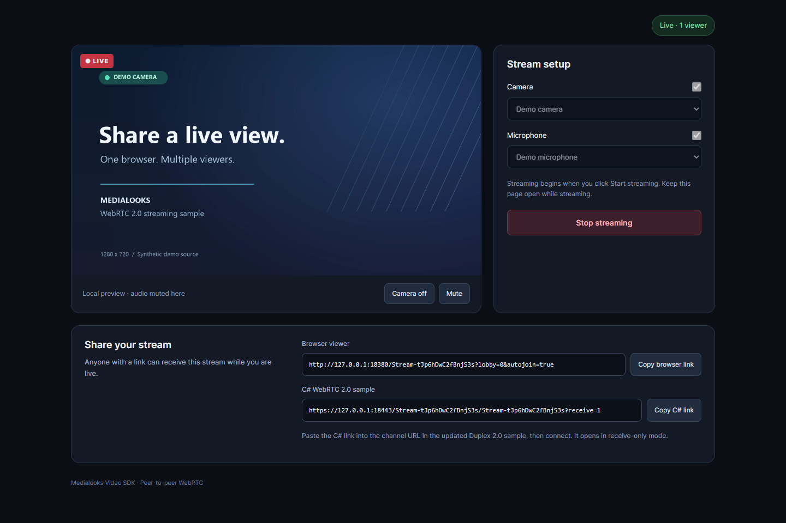
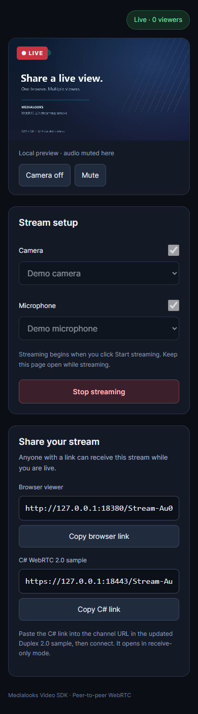
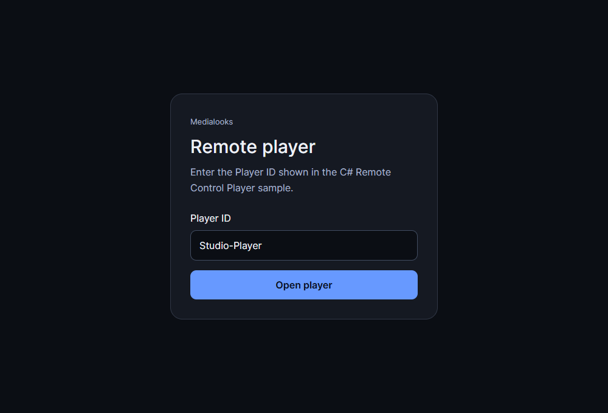
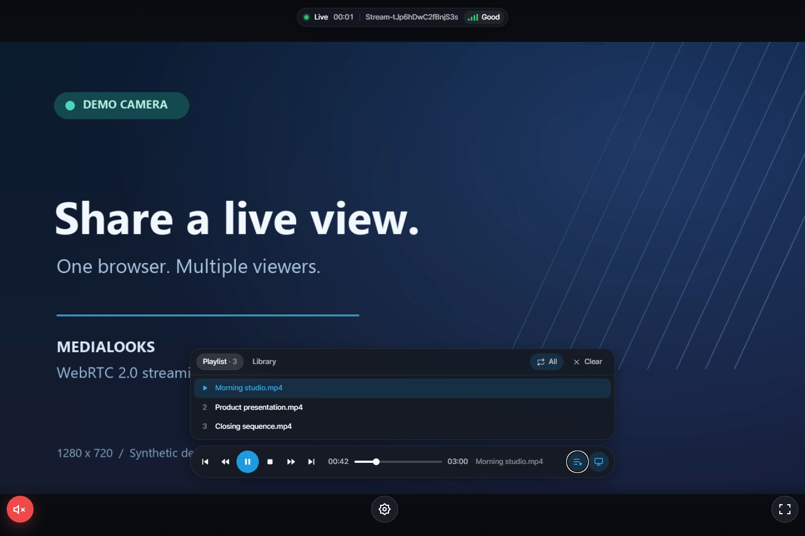

# Medialooks WebRTC 2.0 Signaling Server

Run the signaling server, sample authorization service, and browser pages in one Docker container. Publish a camera and microphone from a browser, receive streams in a browser or compatible C# sample, and control a C# Remote Control Player remotely.

## Quick start

Install Docker with Linux container support and Docker Compose v2. Docker Desktop can be used on Windows and macOS; Docker Engine with the Compose plugin can be used on Linux.

Download and extract the [source code](https://github.com/Medialooks-LLC/WebRTC20_signaling_server/archive/refs/heads/main.zip), or clone it:

```sh
git clone https://github.com/Medialooks-LLC/WebRTC20_signaling_server.git
cd WebRTC20_signaling_server
docker compose up --build -d
docker compose ps
```

Wait until the service is healthy, then open [http://localhost:8080/streamer](http://localhost:8080/streamer).

This starts a local server accessible from the same computer. For phones, other computers, and C# receiving, follow [HTTPS deployment](#https-deployment).

### Use a prebuilt image

You can use the downloadable image instead of building it. Keep the extracted source directory for its Compose configuration.

1. Download `docker-image-linux-amd64.tar.gz` from the [latest release](https://github.com/Medialooks-LLC/WebRTC20_signaling_server/releases/latest).
2. In the download directory, load the archive:

   ```sh
   docker load --input docker-image-linux-amd64.tar.gz
   ```

3. Copy the complete image name printed after `Loaded image:`. In the source directory, create a `.env` file containing that name:

   ```dotenv
   WEBRTC_IMAGE=PASTE_THE_COMPLETE_IMAGE_NAME_HERE
   ```

4. From the source directory, start the loaded image:

   ```sh
   docker compose up -d --no-build --pull never
   docker compose ps
   ```

The downloadable image targets Linux AMD64. The image tag is the value printed by `docker load`; it is separate from the release version.

## Browser pages

Replace the example host below with your server address. A stream or player ID identifies the source you want to connect to.

| Page | Address | Use |
| --- | --- | --- |
| Browser streamer | `/streamer` | Start a camera/microphone stream and copy receiver links |
| Stream viewer | `/<stream-id>` | Watch and listen to a published stream |
| Remote player | `/player` | Enter the Player ID from a C# Remote Control Player |
| Player controls | `/player/<player-id>` | Watch the player's video and control playback |
| Web Guest | `/wg/<host-id>` | Send browser camera/microphone to an existing C# host |
| Web Guest 2 | `/wg2/<host-id>` | Send camera/microphone and receive the C# host's return video/audio |

### Stream from a browser

1. Open `/streamer`.
2. Click **Enable devices** and allow camera/microphone access in the browser.
3. Choose the camera and microphone. Use **Refresh devices** after connecting another device.
4. Click **Start streaming**.
5. Copy the browser link or C# link and send it to the receiver. Keep the publishing page open.

The page provides camera and microphone controls while streaming. **Stop streaming** ends the session; starting again creates a new stream ID and new receiver links. Multiple receivers can watch the same live source.



#### Receive in a browser

Open the **Browser viewer** link from the publisher. If playback or sound does not start automatically, use the viewer's play/audio control. A viewer does not need to enable its own camera or microphone.

#### Receive in C#

Use **Copy C# link** on the publishing page. Paste that link into the channel URL field of a compatible WebRTC 2.0 Duplex receiver sample and connect. The supplied `receive=1` link opens receive-only mode in samples that support it.

C# receiving requires an HTTPS server endpoint. The C# sample projects are maintained separately from this server repository.

<details>
<summary>Phone layout</summary>



</details>

### Control a C# player

1. Start a compatible C# Remote Control Player and connect it to this signaling server.
2. Open the player link shown by the sample, or open `/player`, enter its **Player ID**, and click **Open player**.
3. Enter the player's password if requested.
4. Use the playback controls, timeline, playlist, and library. The library lists media exposed by the connected C# player. Available output devices are also supplied by that player.

Give each simultaneously running player its own Player ID.



The following example shows the controls with a demonstration playlist:



## HTTPS deployment

Use a domain name and a certificate trusted by the receiving devices. Browser camera/microphone capture requires HTTPS except on localhost; opening an HTTP URL with a server's LAN IP does not provide that localhost exception.

### With an HTTPS reverse proxy

Run the container with the default loopback binding, then put your HTTPS reverse proxy on the same host. Forward both the web pages and WebSocket connections to `127.0.0.1:8080`.

For example, install [Caddy](https://caddyserver.com/docs/quick-starts/https) on the Docker host and use this Caddyfile:

```caddyfile
rtc.example.com {
    reverse_proxy 127.0.0.1:8080
}
```

Point the domain's DNS records to the server and allow inbound TCP ports 80 and 443 for Caddy's automatic HTTPS. [Caddy's reverse proxy](https://caddyserver.com/docs/caddyfile/directives/reverse_proxy) handles WebSocket upgrades automatically. This example assumes Caddy runs on the host, alongside Docker.

Start Caddy with this configuration, or apply it through your existing Caddy service. For a foreground run from the directory containing the Caddyfile:

```sh
caddy run --config Caddyfile
```

Open `https://rtc.example.com/streamer`. Browser and C# receiver links will use this public HTTPS address. The internal signaling ports do not need to be published separately.

If the C# SDK must connect through a different public endpoint, add its HTTPS origin to the project's `.env` file:

```dotenv
SDK_SIGNALING_URL=https://sdk.example.com
```

That setting changes the advertised C# endpoint; configure the corresponding HTTPS listener or proxy separately. Apply configuration changes with:

```sh
docker compose up -d
```

### With certificates mounted directly

The supplied TLS configuration lets the container serve HTTPS directly. In the source directory, add the following to `.env`, using absolute certificate/key paths on the Docker host:

```dotenv
TLS_CERT_FILE=/absolute/path/to/fullchain.pem
TLS_KEY_FILE=/absolute/path/to/privkey.pem
WEBRTC_BIND_ADDRESS=0.0.0.0
WEBRTC_TLS_PORT=8443
```

Keep `WEBRTC_IMAGE` in that file if you are using a prebuilt image. Start it with:

```sh
docker compose -f compose.yaml -f docker/compose.tls.yaml up -d --no-build --pull never
```

If you have not loaded or built an image yet, replace `--no-build --pull never` with `--build`.

Open `https://rtc.example.com:8443/streamer`, using the domain covered by your certificate. The certificate and private key are mounted read-only and must be readable by the container's user, UID/GID 1000.

This configuration also retains the HTTP port 8080. When using direct public HTTPS, restrict that HTTP port separately with your host firewall. The reverse-proxy setup above keeps HTTP on loopback by default.

### Server settings

Set these values in the project's `.env` file as needed:

| Setting | Default | Purpose |
| --- | --- | --- |
| `WEBRTC_IMAGE` | `webrtc20-signaling-server:local` | Image to start; use the name printed by `docker load` for a downloaded image |
| `WEBRTC_BIND_ADDRESS` | `127.0.0.1` | Host interface for the published HTTP and optional HTTPS ports |
| `WEBRTC_HTTP_PORT` | `8080` | Host HTTP port |
| `WEBRTC_TLS_PORT` | `8443` | Host HTTPS port when using the TLS configuration |
| `SDK_SIGNALING_URL` | Page's HTTPS origin | Different public HTTPS origin for C# receiver links, if needed |
| `TLS_CERT_FILE`, `TLS_KEY_FILE` | Unset | Host paths used by the optional TLS configuration |

The bundled authorization service provides sample access rules. Adapt it to your application's authentication requirements for a customer-facing deployment. The image contains signaling, web pages, and sample authorization; networks that require media relay may also need a separate TURN service and matching browser/SDK ICE configuration.

## Everyday operation

From the source directory:

```sh
docker compose ps
docker compose logs --tail=100 webrtc
docker compose restart webrtc
docker compose down
```

For a direct-TLS installation, add `-f compose.yaml -f docker/compose.tls.yaml` after `docker compose` when running these commands.

The health endpoint is `/healthz`. A ready server returns HTTP 200 and `"status":"ok"`. Docker also reports the service as healthy.

To update a prebuilt installation, load the new archive, change `WEBRTC_IMAGE` in `.env` to the newly loaded image, and run `docker compose up -d --no-build --pull never`. To update a source-built installation, download or pull the new source and run `docker compose up --build -d`.

## Troubleshooting

| Symptom | Check |
| --- | --- |
| Camera/microphone choices are empty | Use HTTPS or localhost, click **Enable devices**, and allow access in the browser's site permissions |
| C# receiver link is unavailable | Enable HTTPS for the server and reopen the streamer through its HTTPS address |
| A phone cannot open the page | Use the server's public HTTPS name; `localhost` on the phone refers to the phone itself |
| Viewer opens but video does not connect | Confirm the source is still publishing, the proxy supports WebSockets, and the peers have a working ICE/media path; restricted networks may require TURN |
| Remote player is offline or has no controls | Check the Player ID, signaling server address, and that the compatible C# player is running |
| TLS container exits with a file access error | Check the host paths and grant UID/GID 1000 read access to the mounted files while keeping the private key restricted |
| HTTP port is already occupied | Set a different `WEBRTC_HTTP_PORT` in `.env` and recreate the service |
